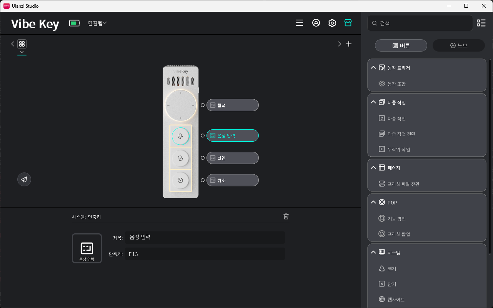

# Ulanze STT 설치 가이드

Ulanzi AU05 Vibe Key의 Voice Key를 누르고 있는 동안 말하면, 로컬 GPU의 Whisper(`large-v3-turbo`)가 인식한 텍스트를 현재 커서 위치에 붙여넣는 프로그램입니다. 인터넷 연결은 모델 최초 다운로드에만 필요하고, 이후에는 오프라인으로 동작합니다.

## 1. 요구 사항

| 항목 | 요구 | 비고 |
|---|---|---|
| OS | Windows 10/11 64비트 | 개발·검증: Windows 11 |
| GPU | NVIDIA (CUDA), VRAM 여유 3GB 이상 | 검증: RTX 3090. 실측: 인스턴스 1개당 VRAM 약 2.4GB (아래 1-1절) |
| NVIDIA 드라이버 | CUDA 12를 지원하는 버전 (525 이상) | CUDA Toolkit은 **설치 불필요** (아래 3단계에서 pip로 받음) |
| 디스크 | 약 4GB | 실측: 가상환경 1.8GB(CUDA 라이브러리 포함) + 모델 1.5GB. uv 다운로드 캐시와 uv가 받는 Python은 별도 |
| 마이크와 트리거 키 | **아무 마이크와 키보드면 됨** (Ulanzi AU05는 선택) | AU05를 쓰면 Ulanzi Studio 3.2.0 이상 필요. 일반 마이크는 4-1절 |
| Python | 3.11 또는 3.12 | **3.13은 사용 불가** (`requires-python <3.13`). uv가 자동으로 받아 주므로 따로 설치하지 않아도 됨 |

NVIDIA GPU가 없으면 이 구성(`device="cuda"`)으로는 실행되지 않습니다. CPU로 돌리려면 `stt.py`의 `device`와 `compute_type`을 바꿔야 하며, 지연이 크게 늘어납니다.

### NVIDIA 드라이버 확인
```powershell
nvidia-smi
```
표 상단의 `CUDA Version`이 12.x이면 충분합니다. 명령이 없으면 https://www.nvidia.com/Download 에서 드라이버를 설치하세요.

### 1-1. 운영 사양 (실측)

측정 환경: Windows 11 Pro 10.0.26300, AMD Ryzen Threadripper PRO 5945WX, RAM 128GB, RTX 3090 24GB, 드라이버 610.88, `large-v3-turbo` float16.

| 항목 | 실측 값 | 측정 방법 |
|---|---|---|
| VRAM | 인스턴스 1개당 약 **2.4GB** (2,385MiB) | 인스턴스 종료 전후 `nvidia-smi` 사용량 차이 |
| 시스템 메모리 | 인스턴스 1개당 약 **750MB** (작업 집합) | 프로세스 WorkingSet |
| 인식 지연 | 평균 약 **270ms**, 최대 약 590ms (3~8초 발화, 벤치마크 10문장) | `bench`의 `run` |
| 모델 로드 | 약 3~5초 (앱 시작 시 1회) | `stt.log` |
| 디스크 | `.venv` 1.8GB + turbo 모델 1.5GB | 폴더 크기 |
| 대기 중 CPU/GPU | 키를 누르지 않는 동안 추론은 하지 않음. 마이크 스트림만 열어 둠 | 설계상 동작 |

**권장 사양 (측정한 것은 위 환경뿐입니다)**
- GPU: VRAM 6GB 이상이면 다른 GPU 작업(게임, 영상 편집)과 함께 써도 여유가 있습니다. 3~4GB 카드는 이 앱만 쓸 때는 가능성이 있으나 **직접 검증하지 않았습니다**. 부족하면 `config.toml`의 `compute_type`을 `int8_float16`으로 바꿔 VRAM을 줄일 수 있지만, 이 경우의 정확도와 VRAM 절감 폭도 측정하지 않았습니다.
- 시스템 RAM: 앱 자체는 1GB 미만이므로 8GB 이상이면 충분합니다.
- CPU: 추론은 GPU가 하므로 CPU 사양의 영향은 작습니다. (CPU 사양별 비교는 하지 않았습니다.)
- GPU를 다른 무거운 작업과 공유하면 인식 지연이 늘 수 있습니다. 위 지연 수치는 그런 부하가 없을 때의 값입니다.
- 모델을 바꾸면 사용량이 달라집니다. `large-v3`와 `medium`의 VRAM은 측정하지 않았습니다. 벤치마크에서 `large-v3`는 지연이 turbo의 약 2.7배였습니다.

### 1-2. 지원 환경과 제한 사항

**운영체제**
| 구분 | 상태 |
|---|---|
| Windows 11 64비트 | 개발·검증 완료 |
| Windows 10 64비트 | 사용에 필요한 기능(Win32 키 훅, 작업 스케줄러, WinMM)은 있으나 **검증하지 않음** |
| Windows on ARM | **미지원** (CUDA용 라이브러리와 휠이 없음) |
| Linux / macOS | **미지원.** `keyboard`의 Windows 훅, `winsound`, `ctypes.windll` 뮤텍스, 작업 스케줄러에 의존 |

**동작상 제한**
- **관리자 권한 창:** 앱이 일반 권한으로 실행되면 관리자 권한으로 띄운 프로그램에는 붙여넣기가 되지 않습니다. UAC 승인 화면과 로그인 화면(보안 데스크톱)에도 입력할 수 없습니다. 앱을 관리자 권한으로 실행하면 해결되지만, 자동 실행 스크립트(`autostart.ps1`)는 일반 권한으로 등록합니다.
- **붙여넣기 방식:** 인식한 텍스트를 클립보드에 넣고 `Ctrl+V`를 전송합니다. 따라서 `Ctrl+V`를 붙여넣기로 쓰지 않는 입력창에서는 동작하지 않습니다(터미널, 원격 데스크톱, 게임 등은 **검증하지 않음**).
- **클립보드 영향:**
  - 붙여넣기 직후 약 0.3초 동안 클립보드가 인식 텍스트로 바뀝니다. 그 뒤 이전 내용을 복원합니다.
  - 복원되는 것은 **텍스트뿐**입니다. 클립보드에 이미지나 파일이 있었다면 복원되지 않고 사라집니다.
  - Windows 클립보드 기록(Win+V)을 켜 두었다면 인식 텍스트가 기록에 남습니다.
- **전역 키 훅:** F13을 감지하려고 모든 키 입력을 보는 훅을 사용합니다. 백신이나 게임 부정행위 방지 프로그램이 이를 의심할 수 있습니다(**검증하지 않음**). 앱은 F13 외의 키는 무시하고 기록하지 않습니다.
- **단일 인스턴스:** 앱을 두 번 띄워도 두 번째는 스스로 종료합니다. 단, 중복 방지가 들어가기 전의 구버전이 떠 있으면 막지 못해 **같은 문장이 두 번 입력**됩니다(실제로 겪었습니다). 업데이트 후에는 이전 프로세스를 모두 종료하세요.
- **발화 길이:** 최대 90초(`audio.max_seconds`)까지 녹음합니다. 키를 뗀 뒤에 한꺼번에 인식하는 방식이라 실시간으로 글자가 나타나지는 않습니다. 인식 시간은 발화 길이에 비례합니다.
- **언어:** 한국어(`ko`)로 고정되어 있습니다. 한국어 문장 속 영어 단어는 인식되지만, 영어로만 말하면 정확도가 떨어질 수 있습니다. 영어 위주로 쓰려면 `whisper.language`를 바꾸세요.
- **마이크:** 기본값은 이름에 `AU05`가 들어간 장치입니다. 다른 마이크도 `audio.device`를 바꾸면 쓸 수 있습니다. AU05는 USB 동글로만 연결됩니다(블루투스 직접 연결 불가, 제조사 정보).
- **절전 복귀:** 절전·최대 절전에서 복귀한 뒤 마이크 스트림이 유지되는지는 **검증하지 않았습니다**. 복귀 후 녹음이 되지 않으면 앱을 재시작하세요.
- **네트워크:** 모델 최초 다운로드에만 필요합니다.
- **Python:** 3.11~3.12만 지원합니다(3.13 불가).

## 2. uv 설치 (Python 관리 도구)

이 프로젝트는 [uv](https://docs.astral.sh/uv/)로 Python과 라이브러리를 관리합니다. uv가 필요한 Python 3.12를 자동으로 내려받으므로 시스템에 Python을 따로 설치하지 않아도 됩니다.

```powershell
winget install --id=astral-sh.uv -e
```
설치 후 **새 터미널**을 열고 확인합니다.
```powershell
uv --version
```
winget을 쓸 수 없으면 `pip install uv` (이미 Python이 있을 때) 또는 공식 문서의 설치 스크립트를 사용하세요.

> 시스템에 Python 3.13만 있어도 문제없습니다. uv가 프로젝트 전용 3.12를 별도로 받아 사용합니다.

## 3. 라이브러리 설치

```powershell
cd E:\works\PROJECTS\UlanzeAgent\app
uv sync
```

`pyproject.toml`에 선언된 항목이 `.venv`에 설치됩니다.

| 패키지 | 용도 |
|---|---|
| `faster-whisper` | Whisper 추론 (CTranslate2 기반). 모델 다운로드도 담당 |
| `sounddevice` | 마이크 입력 (PortAudio 포함) |
| `numpy` | 오디오 배열 처리 |
| `keyboard` | 전역 핫키(F13) 감지와 Ctrl+V 전송 |
| `pyperclip` | 클립보드 복사/복원 |
| `pystray`, `pillow` | 트레이 아이콘 |
| `nvidia-cublas-cu12==12.4.5.8` | GPU 연산용 cuBLAS |
| `nvidia-cudnn-cu12==9.*` | GPU 연산용 cuDNN 9 |

### 버전 고정 이유
- **cuBLAS를 12.4.5.8로 고정:** 최신(12.9 이상)은 Windows용 휠이 없어 `uv sync`가 `can't be installed because it doesn't have a source distribution or wheel for the current platform` 오류로 실패합니다.
- **cuDNN 9:** 현재 CTranslate2는 cuDNN 9를 요구합니다. 8 계열을 넣으면 실행 시 DLL 오류가 납니다.
- 앱은 시작할 때 `.venv\Lib\site-packages\nvidia\*\bin`을 DLL 검색 경로에 등록합니다(`add_cuda_dlls`). 별도로 `PATH`를 건드릴 필요가 없습니다.

## 4. 마이크와 트리거 키 설정

이 프로그램은 **Ulanzi 장치 없이도** 동작합니다. 필요한 것은 (1) 소리를 받을 마이크와 (2) 누르고 있는 동안 녹음할 키 하나입니다. 4-1절은 일반 마이크, 4-2절은 Ulanzi AU05용입니다.

### 4-1. 일반 마이크와 키보드로 쓰기

1. 사용 가능한 마이크를 확인합니다.
   ```powershell
   uv run stt.py --devices
   ```
   ```
   [1] 마이크(USB Sound Blaster HD)  (44100Hz)  <- Windows 기본
   [2] 마이크 배열(Realtek Audio)    (44100Hz)
   ```
2. `config.toml`을 수정합니다.
   ```toml
   [hotkey]
   key = "ctrl+win"        # 이 두 키를 누르고 있는 동안 녹음 (아래 권장 키 참고)

   [audio]
   device = ""             # Windows 기본 마이크. 특정 마이크는 번호(2) 또는 이름 일부("Realtek")
   ```
3. 앱을 다시 실행합니다.

**마이크 선택 규칙:** 같은 장치가 호스트 API별로 여러 번 나타나므로 MME, DirectSound, WASAPI, 그 밖(WDM-KS) 순으로 고르고, 같은 순위에서는 이름에 `마이크`/`mic`이 있는 장치를 먼저 고릅니다. 이름 일부가 여러 장치와 겹치면 번호로 지정하는 것이 확실합니다. 이름 일부로 못 찾으면 기본 마이크로 대체하고 `stt.log`에 경고를 남깁니다.

**트리거 키 권장:**
| 키 | 비고 |
|---|---|
| `ctrl+win`, `right ctrl`, `scroll lock`, `f9` 등 | 글자를 입력하지 않는 키. 권장 |
| `ctrl+alt+space` 등 글자 키가 든 조합 | **누를 때 그 글자도 활성 창에 입력됨.** 앱이 시작할 때 경고를 남김 |
| `f13` | 일반 키보드에는 없음. Ulanzi 장치가 보내는 키 |

- 한국어 키보드의 오른쪽 Alt는 한/영 키로 쓰이므로 `right alt`는 피하세요.
- 목록으로 여러 후보를 줄 수 있습니다. 예: `key = ["f13", "ctrl+win"]`이면 Ulanzi 장치와 키보드 어느 쪽으로도 동작합니다.
- 조합 키의 판정 로직은 가짜 키 이벤트로 검증했습니다(`uv run stt.py --selftest`). **실제 키보드로 `ctrl+win` 등을 누르는 시험은 하지 않았습니다.** Windows가 일부 조합을 자체 단축키로 쓸 수 있으니, 동작이 이상하면 다른 키로 바꿔 보세요.
- 마이크가 작게 들리면 Windows 설정의 입력 볼륨을 올리세요. 이 프로그램은 음량을 자동으로 보정하지 않습니다.

### 4-2. Ulanzi AU05의 Voice Key 사용하기

위 4-1의 `key = "f13"`, `device = "AU05"`가 기본값입니다. 아래는 Voice Key가 F13을 보내도록 Ulanzi Studio에서 바꾸는 과정입니다.

Voice Key가 누르는 동안 `F13` 키를 보내도록 바꾸는 과정입니다. 이 프로그램은 F13이 눌려 있는 동안 녹음합니다.



1. Ulanzi Studio(3.2.0 이상)를 실행합니다. 상단에 `Vibe Key`와 배터리 아이콘, `연결됨`이 보이면 장치가 인식된 것입니다.
2. 가운데 장치 그림에서 마이크 모양의 **음성 입력** 버튼(또는 오른쪽 라벨 `음성 입력`)을 클릭합니다. 선택되면 버튼 테두리가 청록색으로 강조됩니다.
3. 화면 하단에 `시스템: 단축키` 설정 패널이 나타납니다.
   - **제목:** `음성 입력` (표시용 이름이라 바꿔도 동작에는 영향 없음)
   - **단축키:** `F13` 입력
4. 이 버튼에 아직 단축키 동작이 없다면, 오른쪽 목록의 **버튼** 탭 → **시스템** 그룹에서 단축키 동작을 끌어다 놓은 뒤 3번을 진행합니다. 목록이 길어 스크롤해야 보일 수 있습니다.
5. 변경 내용을 장치로 동기화합니다(장치 그림 왼쪽 아래의 종이비행기 아이콘). 동기화 후에는 Studio를 닫아도 설정이 장치에 남아 있습니다.
6. 다른 버튼(`확인`, `취소`, 노브의 `탐색`)은 이 프로그램과 무관하므로 그대로 둡니다.

> **F13을 쓰는 이유:** 일반 키보드에는 없는 키라서 다른 프로그램의 단축키와 충돌하지 않습니다.
>
> **다른 키를 쓰려면:** Studio의 단축키 칸과 `config.toml`의 `[hotkey] key`를 같은 값으로 맞춥니다. 조합키도 지원하지만(4-1절), Studio의 단축키 칸에 글자 키가 든 조합을 넣으면 그 글자가 활성 창에 입력되므로 F13~F24 같은 단일 키를 권장합니다.
>
> **확인 방법:** 메모장에 커서를 두고 `음성 입력` 버튼을 누른 채 말하면 텍스트가 입력됩니다. 반응이 없으면 8절의 키 이벤트 확인 명령으로 F13이 PC에 도달하는지 먼저 확인하세요.

다른 키를 쓰려면 `config.toml`의 `[hotkey] key`를 바꾸면 됩니다. 단, 앱은 스캔코드 100(F13)도 함께 인식합니다.

## 5. 설정 확인 (`config.toml`)

| 키 | 기본값 | 설명 |
|---|---|---|
| `hotkey.key` | `f13` | 누르고 있는 동안 녹음하는 키. 문자열 하나 또는 목록(`["f13", "ctrl+win"]`), 조합은 `+`로 연결 |
| `hotkey.min_seconds` | `0.4` | 이보다 짧은 입력은 무시 (오입력 방지) |
| `audio.device` | `AU05` | 사용할 마이크. `""`/`"default"` = Windows 기본 마이크, 숫자 = 장치 번호, 그 외 = 이름의 일부. 못 찾으면 기본 마이크로 대체하고 로그에 경고 |
| `audio.preroll_ms` | `300` | 키를 누르기 직전 오디오 포함 (첫 음절 잘림 방지) |
| `whisper.model` | `large-v3-turbo` | 모델 이름 |
| `whisper.initial_prompt` | 개발 용어 목록 | 자주 쓰는 용어를 넣으면 인식률 향상 |
| `replacements` | 표 | 인식 결과를 원하는 표기로 치환 |
| `hallucinations.phrases` | 목록 | 무음에서 나오는 환각 문구 제거 |

입력 장치 이름을 확인하려면 다음을 실행합니다.
```powershell
uv run python -c "import sounddevice as sd; print(sd.query_devices())"
```
한글 장치명이 깨져 보이면 `$env:PYTHONUTF8=1`을 먼저 설정하세요.

## 6. 첫 실행

### 6-1. 자체 점검
```powershell
uv run stt.py --selftest
```
- 처음에는 모델(약 1.6GB)을 Hugging Face에서 내려받아 `C:\Users\<사용자>\.cache\huggingface\hub`에 저장합니다. 몇 분 걸릴 수 있습니다.
- 정상이라면 `마이크: [..] 마이크(.. AU05) @ 16000Hz`, 모델 로드 시간, 마이크 녹음 테스트가 출력됩니다.
- `F13 훅: 감지 안 됨`은 이 점검이 가짜 키 입력을 보내기 때문에 나올 수 있습니다. 실제 키로 확인은 6-2에서 합니다.
- 샘플 wav 인식 테스트는 `..\bench\samples`가 있을 때만 의미가 있습니다. 없으면 건너뛰어도 됩니다.

### 6-2. 앱 실행
```powershell
uv run stt.py
```
- 모델 로드에 약 3~5초 걸립니다. `준비 완료. F13 키를 누른 채로 말하세요.`가 나오면 사용할 수 있습니다.
- 메모장 등을 열고 Voice Key를 누른 채 말한 뒤 떼면 텍스트가 붙여넣어집니다.
- 트레이 아이콘: 초록(대기), 빨강(녹음 중), 주황(인식 중). 우클릭 → 종료.
- 로그는 `stt.log`에 저장됩니다. 인식 결과와 지연 시간이 기록됩니다.

콘솔 창 없이 실행하려면 `.venv\Scripts\pythonw.exe stt.py`를 사용합니다.

## 7. 로그인 시 자동 실행

`autostart.ps1`이 작업 스케줄러에 `UlanzeSTT` 항목을 등록합니다(로그인 15초 후, 일반 권한).

```powershell
powershell -ExecutionPolicy Bypass -File .\autostart.ps1           # 등록
powershell -ExecutionPolicy Bypass -File .\autostart.ps1 -Remove   # 해제
Start-ScheduledTask -TaskName UlanzeSTT                            # 지금 시작
```
> `autostart.ps1`은 ASCII로만 작성돼 있습니다. Windows PowerShell 5.1은 BOM 없는 UTF-8을 CP949로 읽어, 한글이 섞이면 줄바꿈이 깨져 `-ExecutionTimeLimit 용어가 cmdlet ... 인식되지 않습니다` 같은 오류가 납니다. 이 파일을 수정할 때 한글을 넣지 마세요.

이미 실행 중일 때 다시 시작하면 새 인스턴스는 스스로 종료합니다(중복 방지).

작업 스케줄러 대신 `shell:startup` 폴더에 `pythonw.exe stt.py` 바로가기를 넣어도 됩니다.

## 8. 문제 해결

| 증상 | 원인과 해결 |
|---|---|
| `uv sync`가 `nvidia-cublas-cu12 ... wheel for the current platform` 오류 | cuBLAS를 `12.4.5.8`로 고정했는지 확인 (`pyproject.toml`) |
| `Could not load library cudnn_...dll` / `cublas64_12.dll not found` | `uv sync`가 끝까지 완료됐는지, `.venv\Lib\site-packages\nvidia\cudnn\bin`이 있는지 확인. 앱을 `.venv` 밖의 다른 Python으로 실행하지 않았는지 확인 |
| `CUDA failed with error ...` | 드라이버가 오래됨 → 최신 NVIDIA 드라이버로 업데이트. GPU 메모리를 다른 프로그램이 점유 중인지 `nvidia-smi`로 확인 |
| `'AU05' 장치를 찾지 못해 기본 입력 장치를 사용` | 동글 연결/인식 확인. 소리 설정 → 입력에 `마이크 (AU05)`가 보이는지 확인. 이름이 다르면 `audio.device` 수정 |
| Voice Key를 눌러도 반응 없음 | Ulanzi Studio에서 키가 F13으로 지정·동기화됐는지 확인. 다음으로 키 이벤트 확인: `uv run python -c "import keyboard; keyboard.hook(lambda e: print(e.event_type, repr(e.name), e.scan_code, flush=True)); keyboard.wait()"` |
| 관리자 권한으로 실행된 창에 붙여넣기가 안 됨 | 일반 권한 프로세스는 상위 권한 창에 키를 보낼 수 없음. 앱을 관리자 권한으로 실행해야 함 |
| 같은 문장이 두 번 입력됨 | 인스턴스 중복. 최신 `stt.py`는 방지하지만, 이전 버전이 남아 있으면 `python.exe`/`pythonw.exe` 중 `stt.py` 프로세스를 모두 종료 후 재시작 |
| 처음 한두 글자가 잘림 | `audio.preroll_ms`를 400~500으로 늘림. 키를 누르자마자 말하기 시작하는 습관이 있는 경우에 해당 |
| 조용할 때 "감사합니다" 등 엉뚱한 문장이 나옴 | Whisper 환각. `hallucinations.phrases`에 해당 문구 추가 |
| 인식이 자주 틀림 | 마이크 거리(입에서 10~20cm)와 Windows 입력 볼륨 확인. 틀리는 용어를 `initial_prompt`와 `replacements`에 추가 |
| 모델 다운로드가 느리거나 실패 | `HF_TOKEN` 환경변수 설정 시 속도 제한이 완화됨. 사내망이면 프록시 설정 필요 |
| `huggingface_hub` symlink 경고 | 무해. 개발자 모드를 켜면 사라짐 (디스크를 조금 더 씀) |

## 9. 제거

1. 자동 실행 해제: `autostart.ps1 -Remove`
2. 실행 중 프로세스 종료: 트레이 아이콘 → 종료
3. 폴더 삭제: `app\.venv` (환경만 지우려면) 또는 프로젝트 전체
4. 모델 캐시 삭제(선택): `C:\Users\<사용자>\.cache\huggingface\hub\models--*faster-whisper-large-v3-turbo*`

## 10. 다른 PC에 설치하기

1. `app` 폴더(`.venv` 제외)를 복사합니다. `pyproject.toml`, `uv.lock`, `stt.py`, `config.toml`, `autostart.ps1`이 필요합니다.
2. 2~7단계를 같은 순서로 진행합니다. `uv.lock`이 있어서 같은 버전이 설치됩니다.
3. `autostart.ps1`은 자신의 위치를 기준으로 경로를 잡으므로 폴더 위치가 달라도 됩니다.
